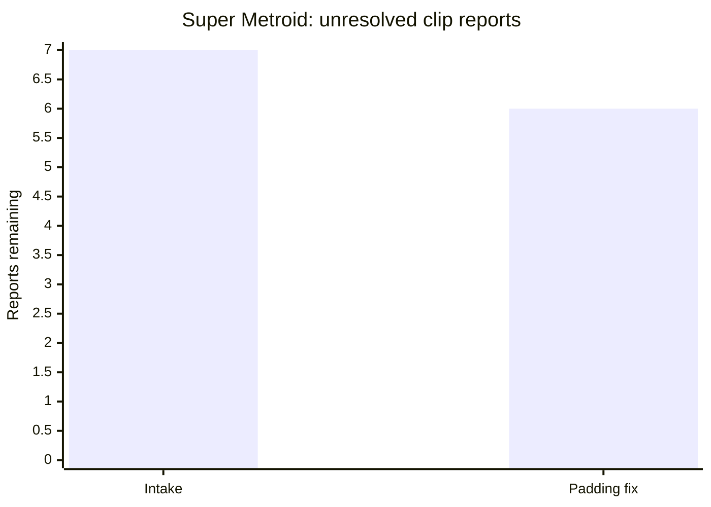

# Super Metroid replay/video bugfix burndown

Updated: 2026-10-28. Tracker: **beads-8wg.6.34**.

Worktree: `G:\Temp\Codex\supermetroid\replay-bugfix-20261027\source`
Branch: `fix/replay-bugfixes-20261027`
Starting game commit: `e617b6573ea090e3bcab2690f4193ce5c2fa4869` (0.3.17).

## Burndown chart

**1 / 7 unique clip reports fixed and validated; 6 unresolved reports deferred by the owner. No active implementation items remain in this pass.**

| Checkpoint | Total unique clip reports | Fixed and validated | Verified existing behavior / duplicate of another row | Unresolved (including deferred) |
| --- | ---: | ---: | ---: | ---: |
| Intake, 2026-10-27 | 7 | 0 | 0 | 7 |
| Room padding fix, 2026-10-28 | 7 | 1 | 0 | 6 |

Append actual milestones to this table and update the chart. Do not invent dates or predicted completion. The seven rows are evidence-backed intake items, **not seven confirmed independent defects**. Split multiple defects from one clip into linked subitems when demonstrated; preserve the original seven-row accounting. A shared fix may resolve multiple rows only after each row's symptom is checked.

## All supplied clips

Names below are exact files in `E:\Downloads`. Scene descriptions and inspection targets are provisional where the intended symptom is not yet established. The owner has not specified a separate symptom for every clip. Infer and investigate from the footage and logs; do not wait for a priority choice to start the clearest actionable item.

| ID | Work order | Clip | Length | Scene / observed candidate | Status | Next decisive check and closure target |
| --- | ---: | --- | ---: | --- | --- | --- |
| SM27-01 | 6 | [clip_1,793,140,731,658.mp4](E:/Downloads/clip_1,793,140,731,658.mp4) | 8.292 s | Plasma Spark `$D340` upper shaft. The black left-margin cutout crosses a boundary between a full `$83FF` padding screen and real `$8210` wall blocks. | **Deferred: intended fault unconfirmed** | Reopen with an intended symptom beyond, or a decision about, the authored padding matte. Room/camera matches and the unresolved interpretation are retained below. |
| SM27-02 | 7 | [clip_1,793,140,528,702.mp4](E:/Downloads/clip_1,793,140,528,702.mp4) | 10.724 s | Morph Ball eye room `$9E9F`; cone activation is visible in the clip, but a definite visual, audio or gameplay fault was not established. | **Deferred: symptom unknown** | The owner cannot identify a more specific symptom and authorized deferral. Keep the original clip; no cone fix is claimed for this report. |
| SM27-03 | 4 | [clip_1,793,140,650,331.mp4](E:/Downloads/clip_1,793,140,650,331.mp4) | 9.717 s | Cathedral `$A788`, jumps above lava. Similar-inventory replays and native pixel checks pass; the alleged alignment/HUD problem was not localized. | **Deferred: defect unconfirmed** | Retain candidate replays 170/171 and captures. Reopen when a concrete failing timestamp/behavior is established; passing static native pixels is not motion acceptance. |
| SM27-04 | 3 | [clip_1,793,140,682,203.mp4](E:/Downloads/clip_1,793,140,682,203.mp4) | 16.136 s | Wave Beam room `$ADDE` to Double Chamber `$ADAD`, then a speed-boosted lava run. Isolated-door frames alone do not establish a phantom-door defect. | **Deferred: transition defect unconfirmed** | Retain the clip and room identities. Reopen with a mismatched door or other concrete failure; do not treat ordinary black transition phases as a demonstrated bug. |
| SM27-05 | 1 | [clip_1,793,140,699,506.mp4](E:/Downloads/clip_1,793,140,699,506.mp4) | 17.250 s | Crocomire `$A98D`. Apparent terrain/liquid discontinuities remain a candidate; sampled original captures, adjacent interpolation and nearby dense replays did not reproduce a definite bad seam. | **Deferred: seam not reproduced** | Retain matched candidate frames/captures and reproduction tools. Reopen with exact presentation/camera timing or another failing capture; no fix or already-fixed claim is made. |
| SM27-06 | 5 | [clip_1,793,140,666,141.mp4](E:/Downloads/clip_1,793,140,666,141.mp4) | 3.181 s | Bubble Mountain `$ACB3`; two original 600-frame candidate segments pass, but the clip movement and a definite fault have not been matched. HUD-edge noise was only a hypothesis. | **Deferred: symptom unknown** | The owner cannot identify a more specific symptom and authorized deferral. Keep the original clip and selected diagnostic frames; no HUD fix is claimed. |
| SM27-07 | 2 | [clip_1,793,140,718,500.mp4](E:/Downloads/clip_1,793,140,718,500.mp4) | 14.085 s | Plasma Spark room `$D340`, lower route: white cross-pattern strip in the left margin (6.35-13.98 s). | **Fixed and validated: complete unused screens clipped** | Built traversal left, right, then left; current-build save/load; immutable before/after capture at camera `(256,1280)`; native pixels unchanged at four widths. See outcome below. |

The suggested order starts with the clearest visible candidates and may change when measurements identify a shared cause or a more consequential defect.

### Duplicate inputs

| Supplied input | Accounting |
| --- | --- |
| `clip_1,793,140,666,141 (1).mp4` | Byte-identical to SM27-06; SHA256 `bc38b2817da48686c7231a4dd7da241a39056998a7c242527adc6f3f9ecb6664`. Covered by SM27-06, not an eighth defect. |
| Concatenated/repeated `clip_1,793,140,731,658.mp4` path in the original message | One file, covered by SM27-01. |

## Replay archive and baseline evidence

Local archive: `E:\Downloads\logs (2).zip`. SHA256: `71dc6d993cbb1bad78c8a6d6e5e9097a363daefa6be425fec7209c83bcc4a9d1`.

There are **1,643 replay segments across six sessions**, all identifying Linux x86_64 0.3.16, game `dc6bdeb054a79ab8ceabae525a4053576c72f644` and engine `246c0d40a8bc5f706bc6ef71d7e8633842f8e42e`. Segments are reproduction data, not additional bug counts. Scan the index and relevant playback failures for additional actionable defects and add any discovered issue explicitly.

| Session | Segments |
| --- | ---: |
| `20261026-155503-21232` | 118 |
| `20261026-161546-22582` | 360 |
| `20261027-025314-24809` | 360 |
| `20261027-045252-26404` | 85 |
| `20261027-051754-26903` | 360 |
| `20261027-162922-28928` | 360 |

Original playback uses the exact published Linux 0.3.16 runtime. Its downloaded ZIP SHA256 `e84d7a1dc19e7d807ad167c008905bb16504233957e9b93887e26264f5b74671` matches published `SHA256SUMS`.

| Selected baseline segment | Candidate scene | Recorded-checkpoint result | Evidence limit |
| --- | --- | --- | --- |
| `20261026-155503-21232-000070` | Eye room `$9E9F` | All 600 executions match | The first captured frame is an elevator/shaft view; it does not validate the cone in SM27-02. |
| `20261026-161546-22582-000170` | Norfair `$A788` | All 600 match | Similar scene/inventory to SM27-03; exact clip timing not established. |
| `20261026-161546-22582-000171` | Norfair `$A788`, later movement | All 600 match | Same limit; motion/presentation need inspection. |
| `20261026-161546-22582-000182` | Bubble Mountain `$ACB3` | All 600 match | Candidate for SM27-06, not proof that its glitch is fixed. |
| `20261026-161546-22582-000325` | Crocomire `$A98D` | All 600 match | Candidate for SM27-05; nine additional sampled capture runs also match all 600 executions. |
| `20261026-155503-21232-000117` | Shaft `$9AD9` | All 600 match | Representative shaft coverage, not a proven match to SM27-01. |

The starting worktree's portable renderer unit suite passes. Six selected captures also preserve every native gameplay pixel in rows 30-223 at widths 256, 342, 448 and 682: **24 comparisons, zero differences among 49,664 native pixels per comparison**. These checks do not certify HUD/margins, intermediate presentations, moving effects, audio, or the seven reported clips.

### Retained local evidence

Evidence is outside the source worktree under `G:\Temp\Codex\supermetroid\replay-bugfix-20261027`:

- [Clip metadata, hashes and contact sheets](../../../evidence/clips.json); sheet names are recorded per clip.
- [Room/inventory/camera replay index](../../../evidence/replay-index.json) and [archive summary](../../../evidence/archive-summary.json).
- [Six original-runtime playback results](../../../evidence/replay-results.json), [Crocomire sample results](../../../evidence/croco-samples.json), and [native pixel comparisons](../../../evidence/native-comparison.json).
- `replays/<scene>/`: selected replay sidecars, muted playback logs and immutable renderer captures.
- `release-original/`: verified original runtime and published checksum list.
- [Resource and cleanup ledger](../../../resource-ledger.json).

These links intentionally refer to this prepared local task directory. Do not commit replay states, videos, ROMs, binaries or large captures into the source repository.

## How to burn this down

1. Work solo in this worktree. Read the current chart, Beads notes and existing fixes before investigating. Start with SM27-05 or SM27-07, and reuse existing captures/tools. Exact clip-to-replay correspondence is still an investigation task.
2. For each row, identify a concrete symptom and timestamp; record the actual original/candidate source and binary identities, room, inputs, renderer/mod settings, viewport, presentation rate and reproduction steps. Prefer the game's debug interface and existing QA tools. Inspect full motion and relevant audio, not only contact sheets. If the intended symptom remains ambiguous after inspection, ask one targeted question and continue an independent row.
3. Reproduce on the original release and current candidate as appropriate. Use the exact original runtime for original-build replay states; do not add cross-version save-state migration or bypass build identity checks. Export diagnostic captures or reconstruct a current-build setup when needed. Keep native SRAM and owner settings intact.
4. Fix the generator/config/runtime source that owns the defect. Never edit generated C. Shared-engine defects belong in a separate isolated engine worktree with an owning engine Bead, linked to this intake. Regenerate fully when generation inputs change. Preserve portable fallbacks and existing working renderer behavior.
5. Validate the actual failing behavior in a built candidate with meaningful focused regression coverage. Preserve native pixel fidelity where applicable; exercise relevant motion, margins, effects, transitions and audio. Check current-build save/load where execution state changes. Reuse representative regression evidence and measure runtime impact when a change could affect frame cost. Passing the old unit suite or merely loading a room is insufficient closure evidence.
6. Update this file and Beads after each meaningful finding, fix and validation result. Record commit IDs and evidence paths. Log reproducible new defects as linked items; preserve individual failures and caveats. A blocked or unverified item stays outstanding.
7. Once automated checks pass, prepare a small bundled owner check only for genuinely remaining visual/control judgments, with a normal window, normal audio, isolated saves and concise steps. Unattended work stays muted and preserves desktop focus. Do not repeat already accepted checks or interrupt an active playtest.

## Closure rules

- **Fixed and validated:** the reported symptom is reproduced or equivalently localized, a concrete source change is built, and the same meaningful check passes on that candidate with retained before/after evidence.
- **Already fixed / verified existing behavior:** retain a direct comparison or current-build reproduction that establishes this conclusion. Explain the result; do not silently dismiss the clip.
- **Duplicate:** link the canonical defect and validate that its resolution covers this clip. Keep both original evidence references.
- **Blocked / unverified:** document the exact missing prerequisite and continue other rows. This does not reduce the remaining count.

On 2026-10-28 the owner authorized deferring reports when their bug cannot be determined. This pass therefore ends with one validated fix and six explicit deferrals. Deferred rows remain unresolved in the burndown; they do not count as fixes or verified existing behavior. Keep their clips, findings and reproduction paths. Commit validated source and this chart; do not merge, publish or release. Preserve useful evidence and clean superseded scratch.

## Findings and completed work

| ID | Concrete symptom / matched timestamp | Root cause / owning issue | Fix commit | Built validation and before/after evidence | Disposition |
| --- | --- | --- | --- | --- | --- |
| SM27-01 | Black cutouts at 3.724/5.213 s; Plasma Spark upper shaft | Authored filler boundary explains shape; intended fault unconfirmed | None | ROM geometry/camera alignment retained; not a validated defect | Deferred by owner; unresolved |
| SM27-02 | Eye cone activation visible; exact fault unknown | Undetermined | None | Same-room baseline and existing cone fixtures are insufficient for this clip | Deferred by owner; unresolved |
| SM27-03 | Norfair movement/lava candidate | Undetermined | None | Original replays 170/171 checkpoints and static native pixels pass; motion fault unlocalized | Deferred by owner; unresolved |
| SM27-04 | Wave Beam to Double Chamber transition/run | Undetermined | None | Room identities established; isolated-door phases not demonstrated wrong | Deferred by owner; unresolved |
| SM27-05 | Candidate Crocomire seams; exact presentation pending | Undetermined | None | Two dense original segments and sampled immutable/interpolated captures; seam not reproduced | Deferred by owner; unresolved |
| SM27-06 | Bubble Mountain movement; exact fault unknown | Undetermined | None | Replays 178/182 each pass 600 checkpoints; full clip movement unmatched | Deferred by owner; unresolved |
| SM27-07 | Left cross-pattern strip, 6.35-13.98 s; Plasma Spark `$D340`, camera `(256,1280)` | Completely unused 256x256 screens filled with `$83FF` inside a nonrectangular room were rendered as level content; beads-8wg.6.34 | `1f41930` | Fresh built traversal in both directions and current-build save/load pass. Same captured frame: 1,128 cross pixels removed at width 342, zero native/right-margin changes. Four widths and three interpolation phases covered by regression fixtures; 28 real scene/width native comparisons pass; 18/18 CTest. | Fixed and validated |

### 2026-10-28: SM27-07 resolved

The decisive room match used visible foreground geometry from the ROM, rather than palette or minimap guesses. The affected room is **Plasma Spark `$D340`**, entered at its bottom-right door `$83:A750`, not Swiss Cheese or the Beach. The original runtime's later traversal `20261027-025314-24809-000254` also identifies `$D340` and matches all 600 recorded checkpoints; it has different inventory and is not the exact video sequence.

The renderer now mattes a complete 256x256 screen only when all 256 level blocks are the ROM's `$83FF` filler. It leaves native pixels alone and preserves any screen containing even one different block, including hidden content and PLM changes. This follows the raster/interpolated terrain coordinates and clips effects/objects with the padding. It does not change scrolling, collision, enemy AI or save data.

Validation: Windows native-raster Release binary SHA256 `1f50d13af577326b4335e003382c23b021717ca2ed8314e01be8f8d2f5e2d7aa`, game base `e617b65` plus this source change; pinned engine `5ac4b98` and UI `ef13e3f`. Muted private QA used a fresh boot/landing, equipment grants, the normal ROM door loader, then normal left/right/left input; no success flags were set. The setup bypasses reaching the door and is not an unassisted progression claim. Current-build save/load retained room/player/inventory and accepted subsequent input. No old checkpoint identity was bypassed.

Retained evidence:

- [Built traversal, both directions and save/load](../../../diagnostics/plasma-spark-padding-final/result.json), with command journal and 117 screenshots in that directory.
- [Same immutable capture before](../../../evidence/padding-same-capture-before.bmp) and [after](../../../evidence/padding-same-capture-after.bmp): native camera `(256,1280)`, width 342, 1,128 changed left-margin pixels, all left-margin gameplay pixels now black, zero native/right-margin changes.
- [28 scene/width comparisons](../../../evidence/padding-comparisons/results.json): all 49,152 native pixels below the HUD match stock and the baseline in every case; the six other selected scenes have no margin changes.
- [18 passing combined tests](../../../evidence/padding-ctest.log). The renderer fixture covers 256/342/448/682 widths, alpha 0/0.5/1, a moving boundary, preserving native pixels and preserving a filled screen with real content.

Other findings remain open. SM27-01's geometry now points toward Plasma Spark's upper shaft rather than the earlier Watering Hole guess, but its black edge cutouts need a separate matched reproduction. SM27-04 starts in the Wave Beam room `$ADDE`, then Double Chamber `$ADAD`; its transitions remain unverified. Direct Ceres-to-Zebes room setups were invalid because common room graphics had not been initialized; these were replaced by fresh landing-based setups. Similar-room screenshots and passing checkpoint hashes are not dispositions for the remaining reports.

### 2026-10-28: owner-authorized deferrals

The owner answered the targeted question about the Bubble Mountain and eye clips: **"I don't konw. defer if you can't determine"**. The same rule is applied to the other reports whose alleged defect remains unconfirmed after the retained checks. The six deferred rows stay in the unresolved count. No speculative source fixes were made for them.

For SM27-01, foreground matching establishes Plasma Spark, with cameras approximately `(512,20)` at 0.0 s, `(256,105)` at 3.724 s, and `(256,108)` at 5.213 s. The left black cutout ends at screen rows 149/146 respectively: the source world's y256 boundary. Its upper-left screen is 256 blocks of `$83FF`; the screen below is 256 genuine `$8210` wall blocks. The conservative matte preserves that real wall. This explains the shape, but does not establish that this was the intended fault, so the report remains deferred. See [source/clip alignment](../../../evidence/shaft-padding-location.json).

SM27-06 candidate replays 178 and 182 each match all 600 recorded checkpoints. Sampled footage comparisons do not establish the same complete movement; the HUD-corruption guess is not a demonstrated diagnosis. SM27-05's retained original frames include nearest candidates around replay 324 frame 194363 and replay 325 frame 194454, plus immutable raster pairs; they do not establish the suspected seam. Wrong-room guesses and invalid pre-landing setups are disposable diagnostics, not regression findings.

Final pass result: **one source fix (`1f41930`), 18/18 combined tests, 28 native scene/width comparisons, current-build save/load and both-direction Plasma Spark traversal pass; six unresolved reports explicitly deferred.** Beads remains open for those reports. No merge, release or owner-facing game launch was performed.
